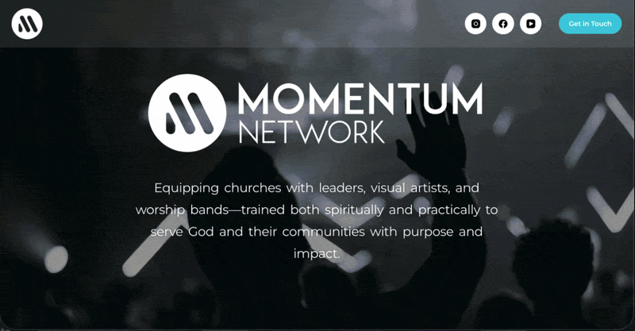
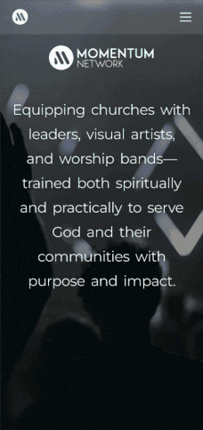

# Momentum Network

A responsive WordPress website designed and developed for Momentum Network, a church-planting organization focused on supporting and developing local churches and leaders.

## Preview

### Desktop

### Mobile

## About the Project

The website was built to give Momentum Network a modern, bold, and approachable online presence while clearly presenting the organization's mission, activities, and community.

The design focuses on strong visual hierarchy, responsive layouts, clear calls to action, and an engaging experience across desktop and mobile devices.

## Features

- Fully responsive design for desktop, tablet, and mobile
- WordPress CMS
- Elementor-based page building
- Custom layouts and styling
- Functional email/mail system
- Newsletter section and call-to-action areas
- Testimonials and organization information sections
- Mobile-optimized navigation and layouts

## Technologies

- WordPress
- Elementor
- HTML
- CSS
- JavaScript

## My Role

Designed and developed the website, including:

- Page layouts and visual design
- Responsive behavior
- Elementor implementation
- Custom CSS styling
- Content structure and section organization
- Email functionality
- Mobile optimization

## Live Website

[Visit Momentum Network](https://momentumnetwork.eu/)

## Project Type

Client Website · WordPress · Responsive Web Design